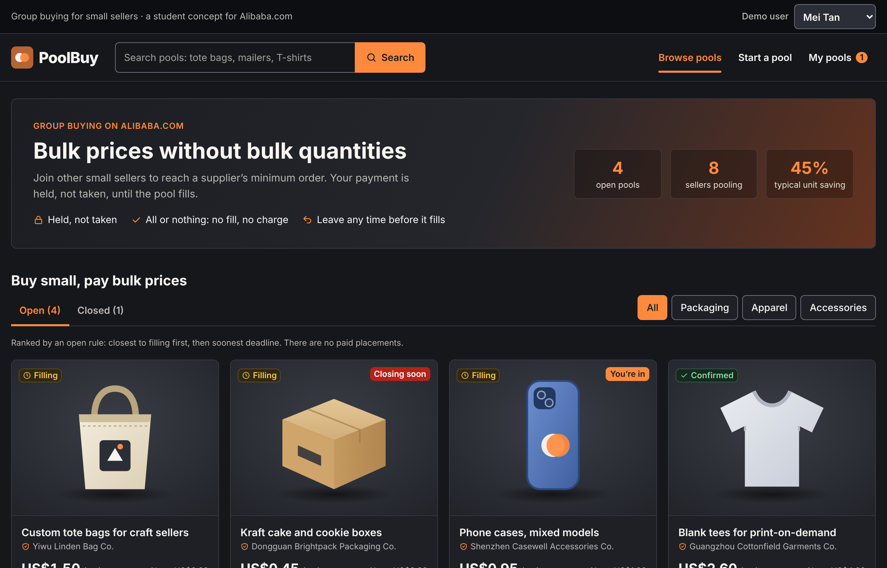
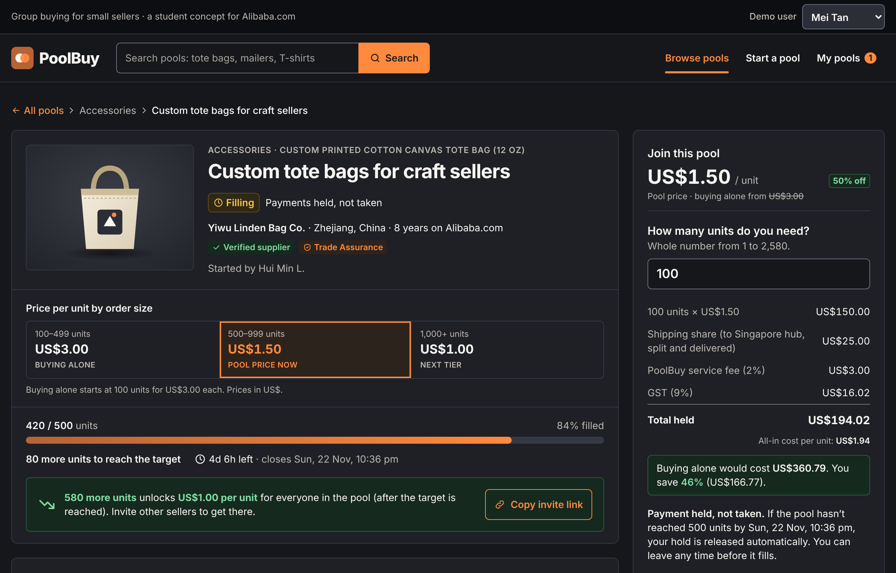
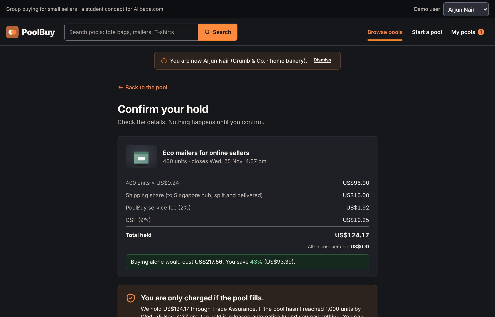
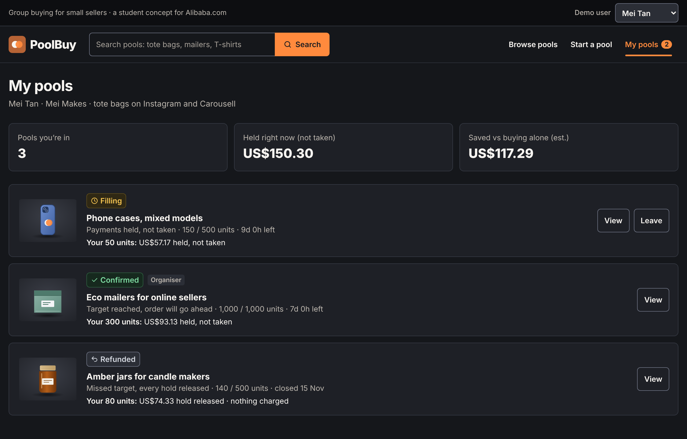

# PoolBuy: buy small, pay bulk prices

**PoolBuy** is a student concept for a group-buying feature on Alibaba.com. Several small sellers combine their orders so that together they reach a supplier's minimum order quantity (MOQ) and its bulk price. Payment is held, not taken, and pools are all-or-nothing: if a pool misses its target by the deadline, every hold is released automatically.

> Student concept prototype for SC4025 (Developing Data Products), NTU. Not affiliated with Alibaba. All suppliers, sellers and prices are made up, and no real payment is taken.

## Run it locally

Needs Node.js 20 or newer.

```bash
cd app
npm ci              # install exact versions from package-lock.json
npm run dev         # http://localhost:5173
npm test            # 99 unit and screen tests
npm run build       # static site in app/dist/
```

Developer notes (project structure, where each business rule lives) are in [`app/README.md`](app/README.md).

## Try it in 3 minutes

1. **Browse pools.** The tote bag pool is at *420 / 500 filled*. Open it to see the price tiers, the full cost breakdown before *Join*, and *"580 more units unlocks US$1.00 per unit"*.
2. **Start a pool** as **Mei Tan**: *Custom poly mailers*, target *1,000 units at US$0.24*, your quantity *300*, 7 days.
3. Switch the **Demo user** (top right) to **Arjun Nair** and join with *400*, then to **Siti Rahman** and join with *300*. The pool turns **Confirmed**.
4. Open **Kraft cake and cookie boxes** (380 / 1,000) and press **Simulate deadline** in the demo controls. It turns **Refunded** and every hold is released.
5. Open **My pools** to see each pool's status as a text label, and **Leave** a pool that is still filling.

*Reset demo data* in the footer restores the starting state.

## Screenshots

| Pool list | Pool detail with cost breakdown |
|---|---|
|  |  |
| **Join confirmation** | **My pools: Filling, Confirmed, Refunded** |
|  |  |

More in [`docs/screenshots`](docs/screenshots), including mobile views. The architecture diagram is in [`docs/prototype/figures`](docs/prototype/figures).

## What the prototype covers

| # | User story | Where to see it | Automated test |
|---|---|---|---|
| 1 | Start a pool for a product (target = supplier MOQ, 3 to 14 day deadline) | *Start a pool* | `actions.test.ts › START_POOL`, `ui.test.tsx › Screen 3` |
| 2 | Join an open pool with my own quantity | Pool detail, join confirmation | `actions.test.ts › JOIN_POOL`, `ui.test.tsx › Screen 4` |
| 3 | Money held until the pool fills; refunded if it fails | Join confirmation, *Simulate deadline*, *My pools* | `actions.test.ts › payment holds` |
| 4 | Full cost per unit (shipping, fee, GST) before joining; nothing added after | Pool detail, join confirmation | `pool.test.ts › cost breakdown`, property test *"never raises any member's hold"* |
| 5 | Units needed to unlock the next price tier | Pool detail (green callout + invite link) | `pool.test.ts › pricing and tiers` |
| 6 | Leave a pool before it fills | Pool detail, *My pools* | `actions.test.ts › LEAVE_POOL`, `ui.test.tsx › Screen 5` |

## Security

Five security checks, each backed by tests or tooling. Full evidence (commands and output) is in [`docs/prototype/security-checks.md`](docs/prototype/security-checks.md).

| Check | What the code does | Result |
|---|---|---|
| **1. Input sanitisation** | Quantities must be whole numbers from 1 to the units remaining (rejects `1.5`, `-3`, `1e3`, scripts). Free text rejects `< >`, `javascript:`, event handlers and control characters, with length limits. Quantities read from the URL are validated again. The production build ships a Content-Security-Policy that only allows our own scripts. | 39 validation tests pass; an injected `<script>` is blocked by the CSP |
| **2. Secrets management** | No API keys, tokens or back end. `.gitignore` excludes `.env*`, keys and certificates. Scanned with `detect-secrets` (27 detectors). | 0 secrets found |
| **3. Auth enforcement** | The demo-user switcher stands in for login and only allows the three demo accounts. **A real version needs authentication** (Alibaba.com sign-in) and server-side checks on every join, leave and payment action. | Documented as a known gap |
| **4. Data privacy** | Only made-up names and businesses. Other sellers see display names (first name + initial) and quantities only; delivery addresses would go to the Singapore hub alone (PDPA data minimisation). A test fails if the seed data ever contains an email, phone number or address. | 0 personal data; privacy test passes |
| **5. Dependency audit** | `npm audit` run on every change; Dependabot enabled in `.github/dependabot.yml`. Runtime code is only React; the Inter font is a self-hosted static file. | 0 vulnerabilities in production dependencies. 1 unpatched upstream advisory in build-only tooling (picomatch ReDoS), not shipped to users |

## Accessibility (WCAG 2.1 AA)

- Every status is a **text label** plus an icon, never colour alone.
- A near-black background, charcoal cards, cream text and one orange accent. Every text colour pair was checked: cream on near-black is **16.5:1**, grey secondary text **8.2:1**, orange links **6.9:1**, and buttons use dark text on orange (**7.4:1**), all above the 4.5:1 AA minimum.
- Status keeps its own colours, amber for Filling, green for Confirmed and grey for Refunded, always with a text label.
- Tap targets are at least 44 px tall, focus is always visible, and the page heading takes focus after each navigation for screen readers.
- An automated **axe-core** audit of all 7 screens at desktop and mobile widths found **0 violations**.

## How it was built: the 70/30 split

The app was generated with an AI app builder from one structured prompt, then refined in 15 follow-up prompts. The AI generated the "bones" (about 70%) and the team supplied the "brain" (about 30%). Every prompt, and the reason for each change, is in the [prompt log](docs/prototype/prompt-log.md).

| AI-generated bones | Team-decided brain |
|---|---|
| Project scaffold (Vite, React, TypeScript, Tailwind), page layouts and components | **All-or-nothing rule**: Confirmed at target; Refunded with every hold released if the deadline passes below target |
| Product illustrations, styling, responsive layout | **Cost breakdown before Join**: units × price + shipping share + 2% fee + 9% GST, with the saving against buying alone |
| Form wiring, routing, state store | **Leave option** only while Filling; once a pool fills, leaving is locked so nobody else's price can rise |
| Test scaffolding and first drafts of documentation | **Price can only go down**: pools quote the target-tier price and unlock deeper tiers for everyone |
| | Unit price fixed by the supplier's tier (organisers can't type a price); verified Trade Assurance suppliers only; open ranking rule with no paid placement |

## Limitations (what a real version needs)

- Real sign-in, a back end and a database. This prototype is front-end only with mock data saved in the browser.
- Real Trade Assurance holds and refunds, and Alibaba.com product data.
- Customs and GST filing for consolidated imports, and the Singapore split hub's operations.
- Supplier opt-in tools and dispute handling for faulty batches.

## Deploying

**GitHub Pages:** in the repository's *Settings › Pages*, set *Source* to **GitHub Actions**. Every push to `main` that changes `/app` then runs the tests and publishes `app/dist` to `https://<github-username>.github.io/<repo-name>/`.

**Anywhere else:** `npm run build` produces a static site in `app/dist/` that any static host (Netlify, Vercel) can serve. `npm run build:single` produces one self-contained `app/dist-single/index.html`.
